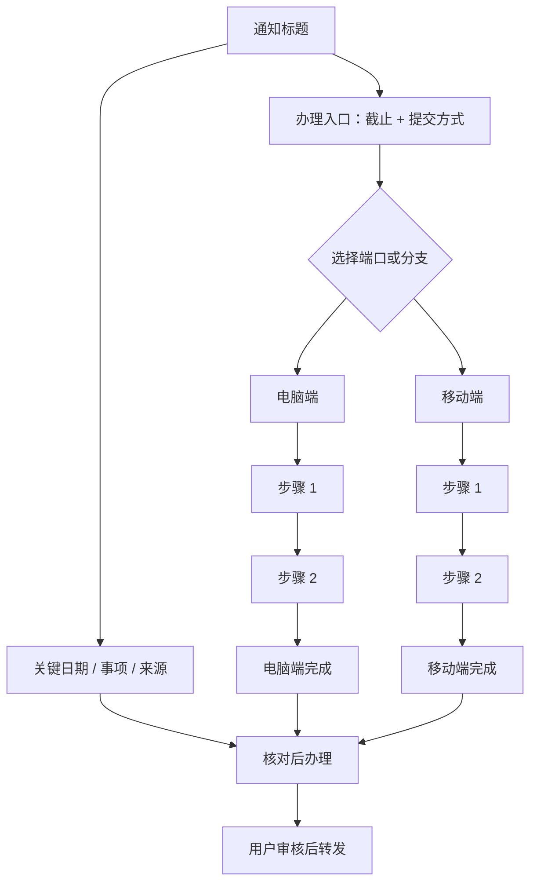
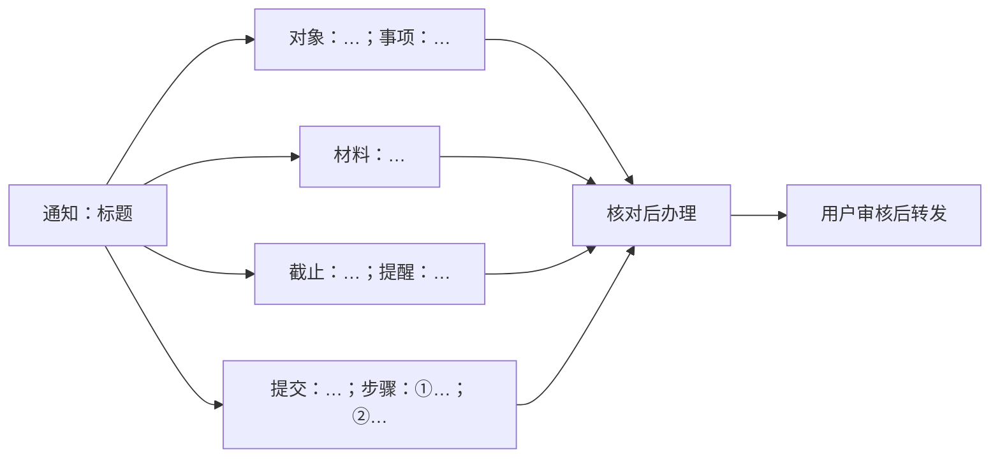

# 通知流程图子 Skill

把已经核对过的通知事实转成“单屏优先”的 Mermaid 流程图，并保留一份适合手机阅读的省流图。它只负责表达事实，不负责猜测、合并事项或发送消息。

## 输入契约

调用前必须已有结构化事实：对象、事项、材料、步骤、截止时间、提交方式、班级统一收交标记、来源和待确认项。缺失字段写“未说明”，不要用常识补齐。一个事项一张图；交错事项先拆开。

用户提供的原文中只要有原通知 HTTP(S) 链接，必须先实际打开并读取链接正文，以及影响办理步骤的链接内附件或图片文字，再与用户原文核对。由 `wechat-notice` 主 Skill 调用时，检查输入是否包含主 Skill 实际读取的链接地址、相关正文内容、来源位置和读取状态；缺少这些材料就先读取链接，不能仅凭网址、标题、卡片、搜索摘要或转述制图。独立调用本 Skill 时自行读取。链接无法读取时说明原因并请求可访问的原文材料，不把未核对图稿作为正式结果；没有链接时按已提供事实制图并注明无链接可核对。

独立调用时检索网页中与当前事项有关的附件或必要图片，下载到用户指定的本地目录；未指定时使用 `~/Downloads/WeChatNotice/<事项标题>/`。安全处理文件名，同名文件分别编号；核实文件存在、非空且可读取后，提取制图所需事实。由主 Skill 调用时复用主 Skill 已下载并核实的附件，不重复下载。对话中列出所需附件的来源网址和本地绝对路径；下载失败标明原因，不把网页卡片当作文件。

制图前使用同一事项的合并事实：链接、用户原文和相关附件中的增量信息合并，相同或近似的事实去重，较具体且不冲突的值保留具体信息。明确更正替换旧值；无法判定的冲突列为待确认，不在图中任选或拼接。由主 Skill 调用时核对其合并结果和各字段来源；独立调用时自行完成合并，不只取其中一份材料。

生成前后做逐字段核对：对象、事项、每项材料、每个步骤、实际截止、提交方式和每个分支的已知值都必须出现在图或配套省流文字中；原文只写“班级”就不能扩写成“全体同学”，已给出的日期或提交方式不能省略。只能使用输入事实或明确的参数计算结果。

若输入同时给出上级截止日和收交提前天数，必须计算并标出班级实际截止日；默认只对班级统一收交计算，个人事项直接保留原截止日。不要把“上级截止日”误当成“班级截止日”，也不要因为需要隐藏而删除内部核对值。

## 图形规则

- 默认生成一张 `flowchart LR` 一页总览：通知标题在左，中间把对象/事项、材料、截止和提交方式并列，右侧汇合到“核对后办理 → 用户审核后转发”。不要把每个字段串成纵向长链。
- 总览只保留关键关系。步骤不超过 3 个且文字较短时合并为一个“步骤”节点；材料不超过 2 项且文字较短时放入一个“材料”节点。
- 出现 4 个以上步骤、3 项以上材料、文字明显过长、判断分支或超过 3 个提醒节点时，拆成章节：总览、办理细节、判断分支、提醒与审核。每张图只表达一个主题，步骤按原顺序串行，互相独立的材料和提醒并列。
- 每张图控制在手机/单屏可读范围；备用渲染以不超过约 1600×1100 像素为目标。仍放不下时继续按步骤或判断点拆分，不缩小文字硬塞。
- 章节之间用“见后图/承接上一图”衔接；每项材料、每个步骤和每个分支必须在某张图或配套省流文字中出现，不能因拆图而省略事实。
- 班级统一收集才使用“按参数提前”的分支；个人提交、报名、考试和活动显示“不提前”。
- 上级原截止时间默认不出现在对外图、润色版、省流版和提醒中；开启展示时四处一致，原件不改。
- 补充、更正或条件选择用明确分支；不确定关联用“待确认”，不要仅因消息相邻合并。
- Mermaid 标签转义引号、方括号、花括号和换行；长材料放配套对话文字或办理细节图，避免总览过密。
- 红框删减规则：用户在参考图中用红框、红线或其他明确标注圈出的内容，视为冗余信息而非通知事实，全部删除，不在其他节点重复；只保留未被标注的事实内容。删除后同步收紧空白、卡片和页脚，不用占位文字替代；不得擅自添加装饰性副标题、徽章、口号、重复提醒、版本号、制作日期或无关元信息，除非用户明确要求。
- 链接显示规则：URL 只能完整显示（包括协议、域名和完整路径）或完全不显示；不得截断域名、缩写路径或使用“网址”占位。若完整 URL 会挤压步骤布局，把它移到办理细节图或配套对话文字，而不是显示半截链接。
- 多步骤事项布局：当通知包含多个连续操作步骤时，各端口或分支必须保留独立的串行步骤，不得把整条路径压缩成一个“电脑端/移动端”节点。可按审查需要使用三种布局：纵向步骤卡（手机优先）、双泳道时间线（端口对照）或选择分支流程（先选端口再串行）；用户未指定时可同时提供三种审查稿，不要擅自把其中一种固化为唯一默认。
- 折返路线校验：跨行连线必须从当前步骤指向下一序号；出图后沿每条箭头逐一核对 `1→2→3→…`，同时检查卡片数字和阅读方向一致。不能让连接线跳过步骤或指向已完成的步骤。

## 模板选择

模板不是唯一解。用户可以在请求中手动指定 `template`；未指定时，根据事项复杂度选择，并在存在明显取舍时提供可审查的候选稿。

- `comprehensive_overview`：综合信息总览。模仿“通知标题/来源 → 日期或关键事实卡片 → 办理入口 → 分支步骤 → 完成结果 → 必要提醒”的一张图，适合用户要求“把所有信息总结在一张图里”或制作通知海报。它可以汇总全篇信息，但每个端口的操作步骤仍必须独立串行，不能把完整路径塞进一个节点；分支只在共同结果处汇合。
- `overview`：一页总览。只放对象、事项、截止、提交出口和审核出口，细节移到后续图。
- `vertical_steps`：纵向步骤卡。电脑端、移动端或其他分支各自向下串行，优先保证手机可读。
- `swimlanes`：双泳道时间线。不同端口或角色并排推进，适合逐步对照。
- `decision_flow`：选择分支流程。先展示“选择办理端/条件”，再进入各自的串行步骤。
- `mobile_summary`：省流图。只保留入口、核心步骤和共同结果，不重复来源、口号或装饰性元信息。

`comprehensive_overview` 的推荐骨架如下；它是可选模板，不覆盖其他模板：

手动指定示例：`template=comprehensive_overview`、`template=vertical_steps` 或 `template=swimlanes`。如果一张综合总览会导致文字过小或步骤无法逐项阅读，保留综合总览作为索引图，并追加办理细节图，不得为了塞进一张图而截断事实。

## 视觉样式

视觉样式与布局模板独立选择。默认 `style=paper`（暖纸质）；用户明确指定 `style=sage` 时使用鼠尾草绿。不再把清透蓝、墨紫对比作为常规候选；除非用户另行要求，不必每次生成多种颜色让用户重选。

- `paper`：暖白纸底（约 `#FAF7F0`）、深灰文字、陶土色重点（约 `#AA6249`），低噪声细边框。用重点色标记步骤编号、连线或最关键动作，不给每个事实配一种颜色。
- `sage`：偏暖浅纸底（约 `#F5F5EC`）、深绿文字、鼠尾草绿重点（约 `#3F735A`），柔和浅绿日期/提示卡。保持文字与底色的清晰对比，不能为了柔和而把字变淡。
- 两种样式都应优先突出办理要求、关键日期和连续步骤；保持卡片层级、箭头方向、字号与留白一致。若在手机单屏内放不下，先精简重复信息或调整排布，不以缩小文字、截断 URL 或牺牲步骤顺序换取美观。

## 固定布局模板

短事项优先套用以下结构，再把事实填入节点；不要额外添加“开始→字段1→字段2”的串行节点：

长事项按以下顺序拆图：

1. `一页总览`：对象、事项、材料概览、实际截止、提交出口和审核出口。
2. `办理细节`：材料并列准备；步骤按原顺序串行，跨图使用“承接上一图”。
3. `判断分支`：每个判断点展示问题、是/否出口和待确认状态。
4. `提醒与审核`：多个提醒节点并列汇入用户审核，不连接微信自动发送。

章节不是固定数量；只要一张图会超出单屏，就继续按步骤或判断点拆分。每张图片标题必须标明章节名，并在对话中按图序展示对应源码与图片；渲染流程若生成 Markdown 或 `package.json`，可同步记录图序，但不能让用户打开这些文件才能看到结果。

## 输出

在对话中同时展示 Mermaid 源码、按章节的渲染图片和省流图片；图片直接内嵌，不只给路径或下载链接。渲染所需的首张技术文件可使用 `flowchart.mmd/png`，后续章节使用 `flowchart-02-*.mmd/png`，但文件只是处理产物，不能代替对话输出。内容较多时按事项、章节分段继续在对话中展示。Mermaid CLI 不可用时在对话中展示源码和本地备用渲染，并在审核说明中标记。图片要核对中文字体、文字截断、日期、手机可读性、单屏高度和原截止时间开关。

## 审核边界

图、文案、原件清单和提醒绑定同一通知版本。用户修改事实、日期、附件、目标群或图稿后，旧批准失效；未审核前不得调用微信发送能力。
